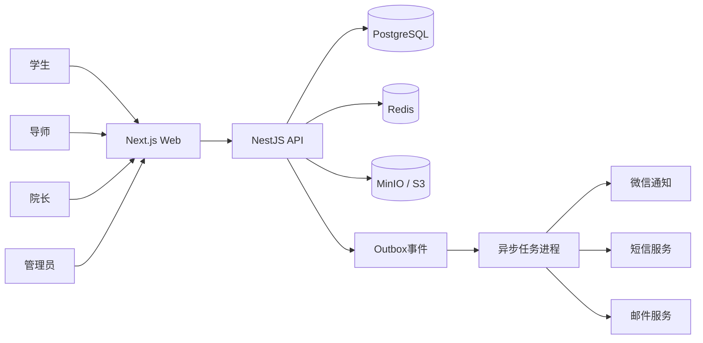
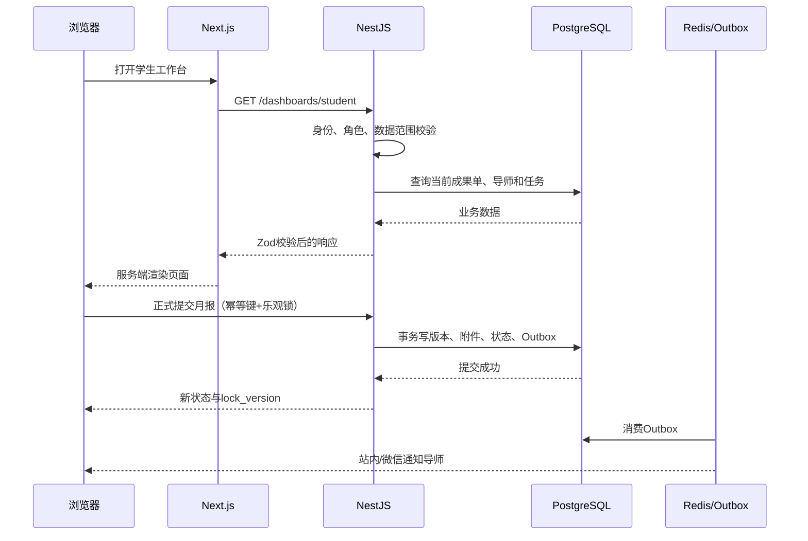

# 研迹技术架构（V1.0）

## 1. 架构目标

首版采用“模块化单体 + 独立异步任务”的演进路线。月报、任务、公告、组织和权限运行在同一个API中，避免早期微服务带来的事务、部署和排障成本；通知发送和文件处理通过队列异步执行，未来达到明确负载边界后再拆分。

## 2. 技术选型

| 层级      | 技术                         | 选择理由                                         |
| --------- | ---------------------------- | ------------------------------------------------ |
| 运行时    | Node.js 24 LTS               | 长期支持，适配当前NestJS工具链                   |
| 包管理    | pnpm 11稳定线                | 单仓库效率高；暂不追刚发布的pnpm 12              |
| Web       | Next.js 16.4、React 19.3     | App Router、服务端渲染、良好的表单和后台页面体验 |
| API       | NestJS 11、Fastify           | 模块化、守卫/拦截器适合RBAC和审计                |
| 契约      | TypeScript、Zod、OpenAPI 3.1 | 前后端共享校验并保留标准API文档                  |
| 主数据库  | PostgreSQL 17                | 事务、约束、JSONB、部分索引和统计能力            |
| 缓存/队列 | Redis 8                      | 会话、限流、定时和通知队列                       |
| 文档存储  | MinIO/S3                     | 私有对象存储与预签名上传                         |
| 测试      | Vitest                       | TypeScript原生、执行快                           |
| CI        | GitHub Actions               | 类型检查、测试、构建和依赖更新                   |

## 3. 系统上下文



## 4. 后端模块边界

```text
auth             手机号、微信、会话、角色切换
identity         用户、档案、组织、数据范围
mentorship       师生关系及历史
monthly-cycle    月度流程配置与成果单生成
submission       月报版本、附件、状态迁移
review           导师审核、评分、退回
task             教学任务与进度
communication    公告、讨论、问答
notification     模板、通知、投递与重试
reporting        导师/院长/管理员统计
audit            操作日志与敏感行为留痕
file             上传意图、校验、预签名下载
```

模块之间通过应用服务调用和领域事件协作。首版禁止模块直接修改其他模块的数据表；需要跨模块事务时由用例层协调。

## 5. 请求链路



## 6. 身份与权限

生产环境建议使用服务端会话：

1. 手机验证码或微信授权完成身份验证；
2. 服务端创建随机会话ID，Cookie设置 `HttpOnly`、`Secure`、`SameSite=Lax`；
3. 会话存Redis，数据库保存身份绑定；
4. 每次请求依次执行认证守卫、角色守卫、数据范围守卫；
5. 敏感操作写审计日志。

当前仓库中的 `DEMO_AUTH_ENABLED`只为本地纵向链路演示。生产启动配置校验必须拒绝该值为 `true`。

## 7. 数据与文件一致性

- PostgreSQL事务是月报状态的唯一事实来源。
- 客户端使用 `Idempotency-Key`，服务端持久化 `client_request_id`防止重复提交。
- `lock_version`采用乐观锁防止学生和导师并发覆盖。
- 文件先直传私有桶，完成SHA-256与文件类型校验后才能关联业务版本。
- 业务事务只写Outbox事件；通知投递失败不会回滚月报提交。
- 文件清理任务只删除超过保留期且没有业务引用的对象。

## 8. 部署拓扑

首期推荐单区域部署：

- 2个Web实例；
- 2个API实例；
- 1–2个Worker实例；
- 托管PostgreSQL主库与自动备份；
- Redis高可用实例；
- 云对象存储或独立MinIO集群；
- 反向代理/WAF统一TLS终止。

API和Worker使用同一代码库但不同启动命令。数据库迁移由独立部署任务执行，应用实例不自动修改生产数据库。

## 9. 可观测性

每个请求生成或传递 `X-Request-Id`。结构化日志至少包含：

- 请求ID、用户ID、当前角色；
- 路由、状态码、耗时；
- 业务资源类型和ID；
- 队列任务ID和重试次数；
- 不包含手机号明文、微信标识、令牌和文档内容。

首期指标：API错误率、P95延迟、数据库连接池、Outbox积压、通知失败率、月报提交率和审核时长。

## 10. 迭代顺序

1. 身份认证与RBAC守卫；
2. 月度周期发布与成果单生成；
3. 文件预签名上传；
4. 学生正式提交事务；
5. 导师审核与版本历史；
6. 通知队列和T-7/T-3/T-1提醒；
7. 院长看板与风险规则；
8. 微信小程序适配和AI辅助功能。

## 11. 架构决策记录

后续重大决策使用 `docs/adr/NNNN-title.md`记录，包括背景、决定、备选方案和后果。首批应记录：模块化单体、服务端会话、对象存储直传、Outbox通知和数据库迁移策略。
