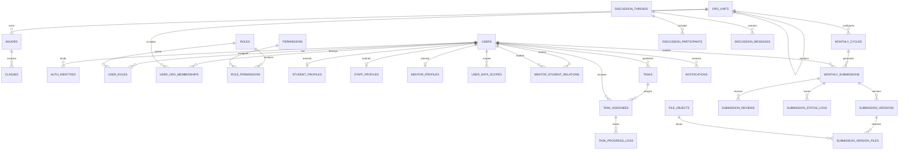

# “112研迹”学生—导师系统数据库设计（V1.0）

## 1. 设计结论

系统采用 PostgreSQL，核心业务对象不是“文件”，而是“学生在某个月度周期中的成果单”。一份成果单允许多次提交版本、多个附件和多次审核，但最终始终对应同一个学生、同一个月度周期，以及当月导师快照。

四个关键设计决定：

1. 用户、登录身份、角色和数据范围相互分离，支持微信/手机号登录和“导师兼院长”。
2. 师生关系保留起止时间；月报保存导师快照，换导师不会破坏历史数据。
3. 月报正文和附件按版本保存，退回重交不覆盖旧内容。
4. “逾期未交”由截止时间动态计算，不作为永久状态保存，避免状态随时间失真。

## 2. 领域关系图



## 3. 模块与表清单

| 模块     | 主要数据表                                                                                                                              | 用途                                                  |
| -------- | --------------------------------------------------------------------------------------------------------------------------------------- | ----------------------------------------------------- |
| 组织     | `org_units`、`majors`、`classes`                                                                                                        | 学校/学院/系、专业和班级                              |
| 账号权限 | `users`、`auth_identities`、`roles`、`permissions`、`user_roles`、`role_permissions`、`user_org_memberships`、`user_data_scopes`        | 统一账号、微信/手机登录、组织归属、RBAC与院长数据范围 |
| 人员档案 | `student_profiles`、`staff_profiles`、`mentor_profiles`                                                                                 | 学生、教职工和导师扩展资料                            |
| 师生关系 | `mentor_student_relations`                                                                                                              | 当前及历史指导关系                                    |
| 月度成果 | `monthly_cycles`、`monthly_submissions`、`submission_versions`、`submission_reviews`、`submission_status_logs`                          | 月度成果完整闭环                                      |
| 文档     | `file_objects`、`submission_version_files`、`task_files`                                                                                | 对象存储元数据及附件关系                              |
| 教学任务 | `tasks`、`task_assignees`、`task_progress_logs`                                                                                         | 导师发布任务、学生更新进度及历史留痕                  |
| 公告交流 | `announcements`、`announcement_audiences`、`announcement_reads`、`discussion_threads`、`discussion_participants`、`discussion_messages` | 公告、问答和讨论                                      |
| 通知     | `notification_templates`、`notifications`、`outbox_events`                                                                              | 站内、短信、微信通知及可靠投递                        |
| 管理审计 | `import_jobs`、`import_job_errors`、`audit_logs`、`system_configs`                                                                      | 批量导入、配置及操作留痕                              |

## 4. 核心数据字典

### 4.1 用户、认证和权限

#### `users`

| 字段                    | 类型           | 约束/说明                        |
| ----------------------- | -------------- | -------------------------------- |
| `id`                    | `bigint`       | 主键，自增                       |
| `user_no`               | `varchar(50)`  | 学号/工号，唯一                  |
| `name`                  | `varchar(100)` | 姓名                             |
| `avatar_url`            | `text`         | 头像地址                         |
| `email`                 | `varchar(255)` | 可空                             |
| `status`                | `varchar(20)`  | `PENDING/ACTIVE/DISABLED/LOCKED` |
| `last_login_at`         | `timestamptz`  | 最近登录时间                     |
| `created_at/updated_at` | `timestamptz`  | 审计时间                         |
| `deleted_at`            | `timestamptz`  | 软删除时间                       |

#### `auth_identities`

一个用户可以绑定多个认证身份。`identifier_hash`用于唯一匹配，`identifier_ciphertext`保存加密后的手机号/OpenID；不保存短信验证码明文。

| 字段                    | 类型           | 说明                                |
| ----------------------- | -------------- | ----------------------------------- |
| `user_id`               | `bigint`       | 用户                                |
| `identity_type`         | `varchar(20)`  | `PHONE/WECHAT/PASSWORD`             |
| `identifier_hash`       | `varchar(128)` | 规范化标识的不可逆摘要              |
| `identifier_ciphertext` | `text`         | 加密后的原始标识                    |
| `credential_hash`       | `text`         | 密码哈希；微信/手机验证码登录可为空 |
| `verified_at`           | `timestamptz`  | 验证时间                            |
| `last_login_at`         | `timestamptz`  | 该方式最后登录时间                  |

唯一约束：`(identity_type, identifier_hash)`。

#### RBAC与数据范围

- `roles`内置 `STUDENT`、`MENTOR`、`DEAN`、`ADMIN`。
- `user_roles`允许一个用户拥有多个角色。
- `permissions`以 `submission.review`、`user.import` 等编码定义操作权限。
- `user_org_memberships`记录导师、院长等人员的主属和兼属学院。
- `user_data_scopes`限定院长能看到哪个学院；管理员可配置 `ALL` 范围。

业务接口必须同时通过“功能权限”和“数据范围”校验，前端隐藏菜单不能代替后端鉴权。

### 4.2 人员与师生关系

#### `student_profiles`

以 `user_id`为主键，包含 `student_no`、`major_id`、`class_id`、`grade`、`enrollment_year`、`degree_level`、`research_status`。

#### `staff_profiles`与`mentor_profiles`

`staff_profiles`存储教职工号、职称、办公室等通用信息；`mentor_profiles`只保存导师独有的研究方向和简介。院长若同时是导师，复用同一个用户，不重复建档。

#### `mentor_student_relations`

| 字段                   | 说明                   |
| ---------------------- | ---------------------- |
| `mentor_id/student_id` | 导师和学生用户ID       |
| `start_date/end_date`  | 指导关系有效期         |
| `is_primary`           | 是否主导师             |
| `status`               | `ACTIVE/ENDED/PENDING` |
| `created_by`           | 建立关系的管理员       |

数据库限制一个学生同一时间只有一个“当前主导师”。历史关系保留，禁止物理删除。

### 4.3 月度成果闭环

#### `monthly_cycles`

| 字段                          | 说明                                   |
| ----------------------------- | -------------------------------------- |
| `scope_org_id`                | 所属学校/学院范围                      |
| `cycle_year/cycle_month`      | 年月                                   |
| `open_at`                     | 开放提交时间                           |
| `remind_at`                   | 首次自动提醒时间                       |
| `deadline_at`                 | 学生截止时间                           |
| `review_deadline_at`          | 导师审核截止时间                       |
| `allow_late/late_deadline_at` | 是否允许及何时停止补交                 |
| `status`                      | `DRAFT/SCHEDULED/OPEN/CLOSED/ARCHIVED` |

同一组织、同一年月只能有一个周期。周期从 `DRAFT` 发布为 `SCHEDULED/OPEN` 后，系统为范围内每个在读学生生成一条 `monthly_submissions`，从而准确统计“应交人数”。

#### `monthly_submissions`

| 字段                                    | 说明                                                     |
| --------------------------------------- | -------------------------------------------------------- |
| `cycle_id/student_id`                   | 唯一确定一份月报                                         |
| `mentor_id`                             | 创建月报任务时的导师快照                                 |
| `mentor_relation_id`                    | 对应师生关系，便于追溯                                   |
| `status`                                | `PENDING/SUBMITTED/REVIEWING/RETURNED/APPROVED/ARCHIVED` |
| `current_version_id`                    | 当前展示版本                                             |
| `first_submitted_at/final_submitted_at` | 首次/最近提交时间                                        |
| `approved_at`                           | 通过时间                                                 |
| `final_score`                           | 0–100分                                                  |
| `is_late`                               | 最近一次正式提交是否逾期                                 |
| `lock_version`                          | 乐观锁版本，防止学生提交和导师审核并发覆盖               |

唯一约束：`(cycle_id, student_id)`。

“逾期未交”的查询规则：当前时间超过 `deadline_at`且状态仍为 `PENDING`。这类状态通过视图动态给出，不写死在主表。

#### `submission_versions`

每次正式提交产生新版本，包含：

- 版本号、标题；
- 本月总结、具体成果、困难与问题；
- 下月计划；
- 学生填写的自评进度；
- 提交说明与提交时间。

同一成果单的 `version_no`唯一。已提交版本不可原地修改；学生修改应新增版本。
客户端为每次提交生成 `client_request_id`，网络重试时复用同一ID，避免重复生成版本。

#### `submission_reviews`

审核操作包括：`START_REVIEW`、`COMMENT`、`RETURN`、`APPROVE`、`RESCORE`。每条记录同时引用成果单和被审核版本，保留审核人、意见、分数与时间。
审核请求同样带有唯一 `client_request_id`，用于安全重试。

#### `submission_status_logs`

保存每次状态迁移：原状态、新状态、操作者、原因和时间。它是院长查看导师动态以及系统审计的重要依据。

### 4.4 文件

`file_objects`只保存文件元数据和对象存储键，文件内容保存在 MinIO、OSS 或 COS。至少记录：原始文件名、MIME类型、大小、SHA-256摘要、上传人、存储桶和对象键。

允许的月报附件类型首期建议限制为：

- `.doc`、`.docx`
- `.pdf`
- `.ppt`、`.pptx`

上传时必须同时校验扩展名、MIME类型、文件头和大小，不能只信任浏览器传来的文件名。

### 4.5 通知与可靠投递

`notifications`为每位接收者、每个渠道生成独立消息。`idempotency_key`为唯一键，例如：

```text
monthly-reminder:{cycle_id}:{student_id}:T-7D:WECHAT
```

即使定时任务重复执行，也不会向同一学生重复发送同一阶段提醒。

`outbox_events`与业务事务一同写入，后台投递器再发送短信/微信消息，避免“数据库已提交但通知任务丢失”。

推荐提醒节奏：

- 截止前7天：提醒未提交学生；
- 截止前3天：再次提醒；
- 截止前1天：紧急提醒；
- 截止后：通知学生逾期，并同步导师；
- 导师审核超时：提醒导师。

## 5. 核心状态流转规则

| 当前状态              | 操作       | 下一状态    | 操作者      |
| --------------------- | ---------- | ----------- | ----------- |
| `PENDING`             | 首次提交   | `SUBMITTED` | 学生        |
| `SUBMITTED`           | 开始审核   | `REVIEWING` | 导师        |
| `SUBMITTED/REVIEWING` | 退回       | `RETURNED`  | 导师        |
| `RETURNED`            | 提交新版本 | `SUBMITTED` | 学生        |
| `SUBMITTED/REVIEWING` | 审核通过   | `APPROVED`  | 导师        |
| `APPROVED`            | 月度归档   | `ARCHIVED`  | 系统/管理员 |

限制：导师只能审核创建月报任务时分配给自己的学生；院长拥有只读监督权限，不能替导师通过或改分；管理员可以处理异常流程，但所有强制变更必须进入审计日志。

## 6. 推荐索引与查询

关键索引已经包含在建表脚本中，主要支持：

- 某周期全部未提交学生；
- 某导师待审核月报；
- 某学生完整成长时间轴；
- 某学院某月提交率和通过率；
- 待发送或失败待重试通知；
- 用户操作和状态变化审计。

报表查询不要直接扫描文件表，应以 `monthly_submissions`为事实表，按周期、组织、导师和状态聚合。

## 7. 数据安全与保留策略

1. 手机号、微信OpenID采用应用层加密，并另存不可逆摘要用于查找。
2. 密码使用 Argon2id 或 bcrypt，不允许可逆加密。
3. 文件使用私有对象存储，通过短时签名URL下载。
4. 院长的数据权限限定到组织范围；导师限定到有效或历史师生关系。
5. 月报版本、审核记录和审计日志原则上不可物理删除。
6. `audit_logs.before_data/after_data`禁止记录密码、验证码、访问令牌等秘密信息。
7. 数据导出、批量下载、管理员强制改状态均写入审计日志。

## 8. 开发落地顺序

1. 执行 `schema-postgresql.sql`创建数据库结构。
2. 初始化四个角色及权限编码。
3. 完成手机号/微信身份绑定和后端权限中间件。
4. 实现组织、人员导入和师生关系管理。
5. 实现月度周期发布、成果单生成、版本提交和导师审核。
6. 接入对象存储与可靠通知任务。
7. 基于动态视图开发导师驾驶舱和院长统计页。

## 9. 下一设计阶段

数据库结构确定后，下一阶段应完成“接口与页面原型设计”：明确每个角色的菜单、页面字段、按钮权限、REST API、状态迁移接口和通知定时任务。完成这一阶段后即可初始化后端与前端仓库。
